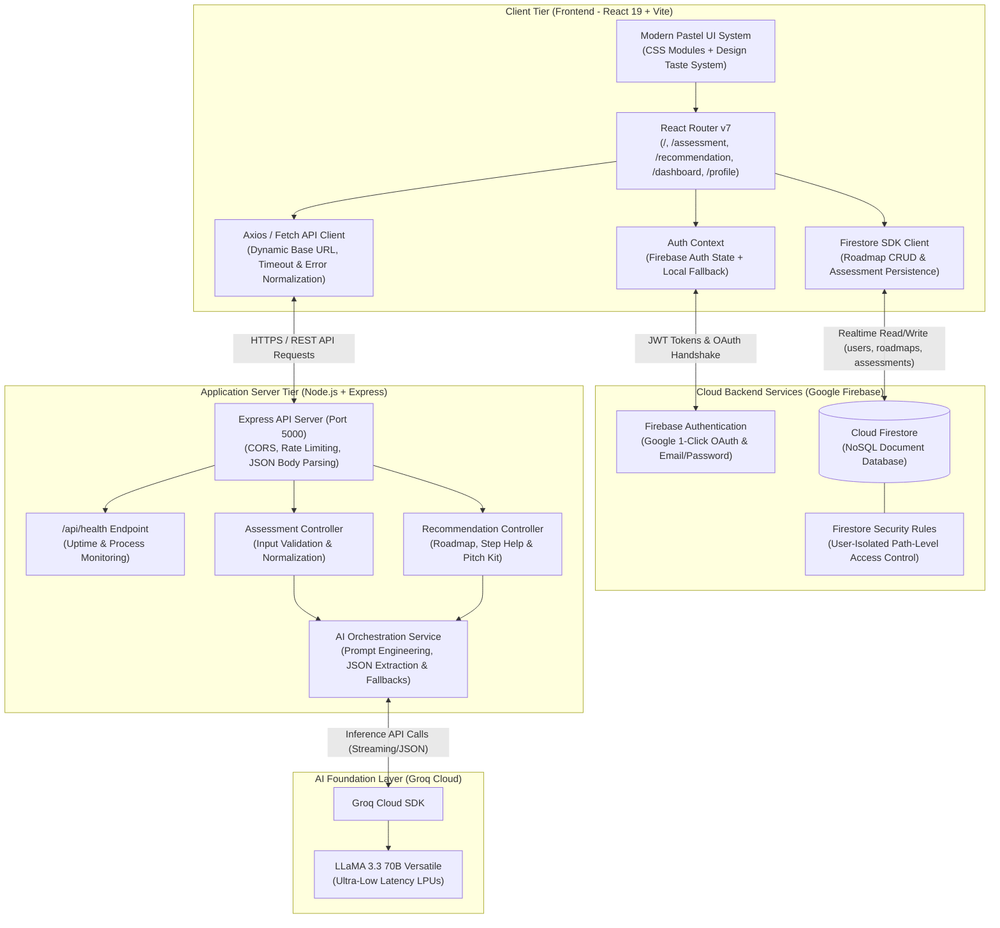
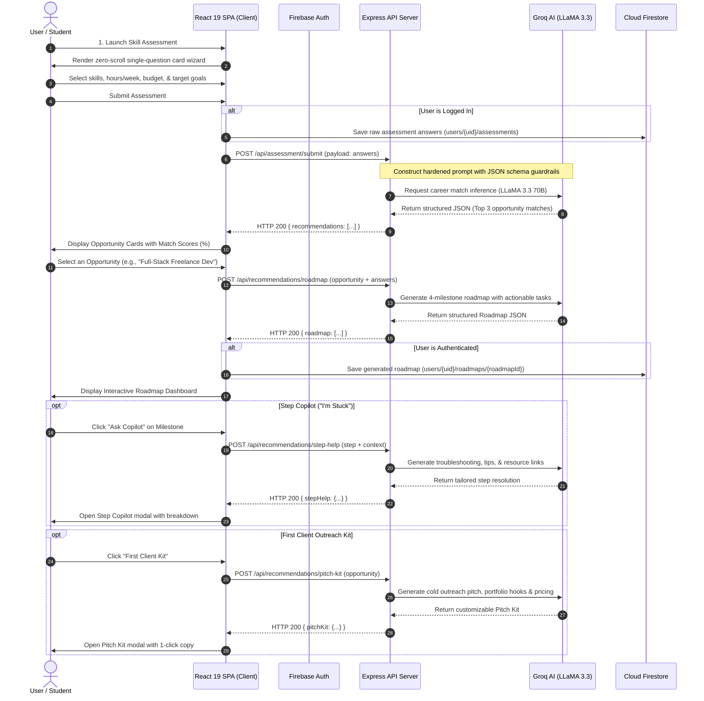

# ✦ SkillPath AI — Intelligent Career & Income Roadmap Engine

> Turn your unique skills, time bandwidth, and budget into realistic freelance paths, side ventures, and actionable step-by-step roadmaps. Powered by **Groq LLaMA 3.3 70B**, **React 19**, **Node.js**, and **Firebase (Auth & Cloud Firestore)**.

---

## 📑 Table of Contents
- [Architecture Overview](#-architecture-overview)
  - [1. System Topology Diagram](#1-system-topology-diagram)
  - [2. Assessment & Roadmap Lifecycle Sequence](#2-assessment--roadmap-lifecycle-sequence)
- [Key Features](#-key-features)
- [Tech Stack](#-tech-stack)
- [Project Directory Structure](#-project-directory-structure)
- [Getting Started](#-getting-started)
  - [Prerequisites](#prerequisites)
  - [Environment Setup](#environment-setup)
  - [Firebase Configuration](#firebase-configuration)
  - [Running the Application](#running-the-application)
- [API Reference](#-api-reference)
- [Database Schema (Firestore)](#-database-schema-firestore)
- [Security & Rules](#-security--rules)

---

## 🏛 Architecture Overview

SkillPath AI is architected as a decoupled, multi-tier full-stack application designed for sub-second AI inference, persistent user data synchronization, and high client responsiveness.

### 1. System Topology Diagram



---

### 2. Assessment & Roadmap Lifecycle Sequence



---

## 🌟 Key Features

1. **Zero-Scroll Focused Assessment Stepper**
   - Single-question card interface that auto-advances on selection.
   - Smooth pastel category indicator and step progress bar.
   - Fully accessible with keyboard navigation and tactile click states.

2. **AI Career & Income Matcher**
   - Evaluates current skills, weekly time commitment, learning preference, and budget.
   - Generates 3 viable career and side income paths with realistic monthly earnings, difficulty ratings, and match percentages.

3. **Interactive Milestone Roadmap**
   - 4-phase structured curriculum (Foundations $\rightarrow$ Practical Building $\rightarrow$ Monetization $\rightarrow$ Client Acquisition).
   - Real-time milestone progress tracking with ink-drawn checkmarks and completion percentages.

4. **"I'm Stuck" Step Copilot (Standout Feature 1)**
   - Context-aware AI debugging and guidance modal for any difficult milestone.
   - Provides concrete micro-steps, beginner pitfalls to avoid, and verified learning resources.

5. **First Client Outreach & Pitch Kit (Standout Feature 2)**
   - Turnkey freelance templates: high-converting cold email pitch, Upwork/Fiverr proposal text, portfolio proof concepts, and competitive starter pricing formulas.

6. **Firebase Cloud Persistence & Offline Fallback**
   - Google 1-Click Sign-In and secure Email/Password authentication.
   - Cloud Firestore auto-syncs user assessments and roadmap progress across all devices.
   - Resilient offline fallback: functions seamlessly even before Firebase keys are added.

7. **Pastel Editorial Visual Design System**
   - Custom palette: Forest Sage (`#246B5F`), Mint (`#2DD4BF`), Lavender (`#DDD6FE`), Soft Sand (`#FEF3C7`), and Obsidian (`#18181B`).
   - Double-bezel cards, kinetic button-in-button trailing icons, and custom geometric monoline vector favicon.

---

## 🛠 Tech Stack

| Domain | Technology | Purpose |
| :--- | :--- | :--- |
| **Frontend Framework** | React 19 + Vite | High-performance SPA with instant Hot Module Replacement (HMR) |
| **Routing** | React Router v7 | Declarative client-side routing and navigation guards |
| **Styling & Design** | Pure Modern CSS3 | Custom typography, double-bezel cards, pastel palette, fluid animations |
| **Cloud Authentication** | Firebase Auth v11 | Secure session handling, Google OAuth popup, Email/Password accounts |
| **Cloud Database** | Cloud Firestore | Realtime NoSQL document database for user profiles, roadmaps, and progress |
| **Backend Runtime** | Node.js (v18+) & Express | Lightweight REST API server with CORS and error middlewares |
| **AI Foundation Engine** | Groq Cloud SDK | Ultra-low latency inference using **LLaMA 3.3 70B Versatile** |
| **Icons & Branding** | Custom Vector SVG | Hand-crafted geometric "S-Path" vector monogram and favicon |

---

## 📂 Project Directory Structure

```text
Skill-Path-AI/
├── .agents/                 # Local design and frontend taste skills (git-ignored)
├── client/                  # Frontend SPA (React 19 + Vite)
│   ├── public/              # Static assets & custom SVG favicon
│   │   ├── favicon.svg      # Modern geometric "S-Path" vector favicon
│   │   └── robots.txt
│   ├── src/
│   │   ├── components/      # UI component architecture
│   │   │   ├── assessment/  # Stepper, OptionCard, ProgressBar, AnalyzingLoader
│   │   │   ├── auth/        # AuthPromptModal
│   │   │   ├── dashboard/   # RoadmapStep, StepHelpModal, PitchKitModal
│   │   │   ├── home/        # Hero Landing, Features, Success Stories, CTA
│   │   │   ├── layout/      # Navbar (island pill), Footer, Layout wrapper
│   │   │   ├── profile/     # SavedRoadmap cards, Stats
│   │   │   ├── recommendation/# OpportunityCard, MatchScore, ProfileSummary
│   │   │   └── ui/          # BrandLogo, Button, Input (with show/hide), Modal
│   │   ├── context/         # AuthContext (Firebase Auth + Fallback mode)
│   │   ├── pages/           # Assessment, Dashboard, Recommendation, Profile, Auth
│   │   ├── services/        # api.js (Express endpoints), firebase.js, firestoreService.js
│   │   ├── styles/          # global.css, components.css, layout.css, pages.css
│   │   ├── App.jsx          # Route definitions & navigation architecture
│   │   └── main.jsx         # Application entry point
│   ├── .env.example         # Template for client environment variables
│   ├── index.html           # Document shell with SEO and OpenGraph metadata
│   ├── package.json         # Frontend dependencies & build scripts
│   └── vite.config.js       # Vite configuration & server proxy rules
├── server/                  # Backend REST API (Node.js + Express)
│   ├── config/              # db.js (optional MongoDB connection)
│   ├── controllers/         # assessmentController.js, recommendationController.js
│   ├── routes/              # assessmentRoutes.js, recommendationRoutes.js
│   ├── services/            # aiService.js (Groq SDK + LLaMA 3.3 orchestration)
│   ├── .env.example         # Template for backend environment variables
│   ├── package.json         # Backend dependencies & scripts
│   └── server.js            # Express server entry point & middleware stack
├── firestore.rules          # Production security rules for Cloud Firestore
├── package.json             # Root monorepo workspace scripts
└── .gitignore               # Strict ignore rules for secrets, builds, and node_modules
```

---

## 🚀 Getting Started

### Prerequisites
- **Node.js**: v18.0.0 or higher
- **npm**: v9.0.0 or higher
- **Git**

### Environment Setup

#### 1. Configure Frontend Environment (`client/.env`)
Copy the client template:
```bash
cp client/.env.example client/.env
```
Populate with your Firebase project keys:
```env
VITE_API_BASE_URL=http://localhost:5000/api

VITE_FIREBASE_API_KEY=AIzaSy...
VITE_FIREBASE_AUTH_DOMAIN=your-app.firebaseapp.com
VITE_FIREBASE_PROJECT_ID=your-app
VITE_FIREBASE_STORAGE_BUCKET=your-app.appspot.com
VITE_FIREBASE_MESSAGING_SENDER_ID=123456789
VITE_FIREBASE_APP_ID=1:123456789:web:abcdef
```

#### 2. Configure Backend Environment (`server/.env`)
Copy the server template:
```bash
cp server/.env.example server/.env
```
Populate with your Groq API key (free at [console.groq.com](https://console.groq.com/keys)):
```env
PORT=5000
CLIENT_URL=http://localhost:5173
GROQ_API_KEY=gsk_...
```

---

### Firebase Configuration

1. In the [Firebase Console](https://console.firebase.google.com/), go to **Authentication** $\rightarrow$ **Sign-in method** and enable:
   - **Email/Password**
   - **Google**
2. In **Firestore Database**, create a database and paste the security rules from [`firestore.rules`](./firestore.rules):
```javascript
rules_version = '2';
service cloud.firestore {
  match /databases/{database}/documents {
    match /users/{userId} {
      allow read, write: if request.auth != null && request.auth.uid == userId;
      
      match /assessments/{assessmentId} {
        allow read, write: if request.auth != null && request.auth.uid == userId;
      }
      
      match /roadmaps/{roadmapId} {
        allow read, write: if request.auth != null && request.auth.uid == userId;
      }
    }
  }
}
```

---

### Running the Application

From the root directory:

```bash
# Install all dependencies (both client and server)
npm run install:all

# Start both backend and frontend concurrently in development mode
npm run dev
```

Or run each service individually:

```bash
# Terminal 1: Backend API (runs on http://localhost:5000)
cd server
npm run dev

# Terminal 2: Frontend SPA (runs on http://localhost:5173)
cd client
npm run dev
```

---

## 📡 API Reference

All backend endpoints are prefixed with `/api`:

### 1. Health Check
- **`GET /api/health`**
  - Returns: `{ status: "ok", timestamp: "..." }`

### 2. Career Assessment Matching
- **`POST /api/assessment/submit`**
  - **Payload**: `{ answers: { skills: [...], hours: "...", budget: "...", ... } }`
  - **Returns**: `{ recommendations: [ { title, matchScore, description, averageIncome, difficulty, skillsRequired, timeline } ] }`

### 3. Generate Roadmap
- **`POST /api/recommendations/roadmap`**
  - **Payload**: `{ opportunity: { title: "..." }, answers: { ... } }`
  - **Returns**: `{ roadmap: [ { step: 1, title: "...", duration: "...", tasks: [...], tips: [...] } ] }`

### 4. "I'm Stuck" Step Copilot
- **`POST /api/recommendations/step-help`**
  - **Payload**: `{ step: { title: "...", tasks: [...] }, currentSkills: [...] }`
  - **Returns**: `{ stepHelp: { simplifiedExplanation, breakdownSteps, commonPitfalls, recommendedResources } }`

### 5. First Client Outreach & Pitch Kit
- **`POST /api/recommendations/pitch-kit`**
  - **Payload**: `{ opportunity: { title: "..." }, targetClient: "Small Business / Startup" }`
  - **Returns**: `{ pitchKit: { coldEmailTemplate, proposalTemplate, portfolioAngle, starterPricing } }`

---

## 🗄 Database Schema (Firestore)

```text
users/
  └── {userId}/
        ├── createdAt: timestamp
        ├── email: string
        ├── displayName: string
        │
        ├── assessments/
        │     └── {assessmentId}/
        │           ├── timestamp: timestamp
        │           ├── answers: object
        │           └── recommendations: array
        │
        └── roadmaps/
              └── {roadmapId}/
                    ├── opportunityTitle: string
                    ├── completedMilestones: number[]
                    ├── roadmap: array
                    └── updatedAt: timestamp
```

---

## 🔒 Security & Rules
- **Zero Secrets Committed**: All `.env` files are ignored by git; `.env.example` provides safe, mock templates.
- **Client-Side Sanitization**: Inputs are sanitized before sending to the backend.
- **AI Prompt Injection Guardrails**: Strict JSON schema extraction and regex verification prevent model hallucinations.
- **Firestore Path-Level Isolation**: Users can only read and mutate their own document subtrees.

---

## 📄 License
This project is licensed under the MIT License — feel free to use, modify, and build upon it!
